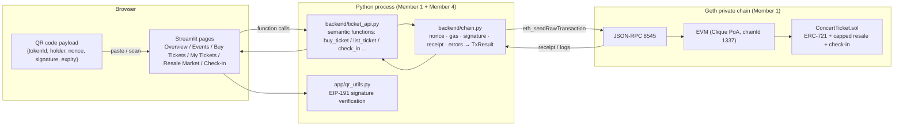

# System Architecture (Member 1 / Member 4 perspective)



## 1. Why three layers

| Layer | Responsible for | Not responsible for |
|---|---|---|
| Contract | All **non-bypassable** rules: per-wallet limit, price cap, resale count, one check-in per ticket | User experience, page layout |
| `ticket_api.py` | Wraps contract functions in business semantics, computes amounts, returns a uniform `ok/tx_hash/gas_used/error` | Does not re-implement rules (does not replace on-chain validation) |
| Streamlit | Display, interaction, QR codes | **Never treats "front-end validation passed" as an approval decision** |

Every "can / cannot" on a page is ultimately decided by a `require` in the contract. The `canPurchase` pre-check on the page only exists to avoid sending a transaction that is doomed to fail
and would still cost gas; it is a UX optimisation, not a security boundary.

## 2. Full path of a single ticket purchase

```
User clicks "Buy now"
  → app/pages/2_buy.py: api.buy_ticket(event_id, "buyerB", 1)
  → backend/ticket_api.py: read concertEvents(eventId) for the ticket price, build purchaseTickets{value: price*qty}
  → backend/chain.py: estimate_gas (on failure return the revert reason directly, no gas spent)
                      get_transaction_count(pending) → nonce
                      maxFeePerGas = baseFee*2 + 1 gwei
                      eth_account local signature → eth_sendRawTransaction
                      wait_for_transaction_receipt (timeout 120s)
  → returns TxResult(ok, tx_hash, block_number, gas_used)
  → the page then calls ownerOf(tokenId) to read back the real ticket owner and compare
```

## 3. Mapping between on-chain state and front-end fields

| Page field | Source |
|---|---|
| Event name / ticket price / supply / per-wallet limit / presale | `concertEvents(eventId)` (getter of the public mapping) |
| Remaining tickets | `remainingSupply(eventId)` |
| Ticket owner | `ownerOf(tokenId)` |
| Whether on sale / listing price / resale count / whether checked in | `tickets(tokenId)` |
| Which event the ticket belongs to | `tokenToEvent(tokenId)` |
| Dynamic resale price cap | `getMaxResalePrice(tokenId)` |
| Purchase eligibility pre-check | `canPurchase(eventId, account, qty)` |
| My tickets list | Scan `Transfer` events + re-check each one with `ownerOf` (the contract does not inherit ERC721Enumerable) |
| Transaction evidence / Gas | `eth_getTransactionReceipt` |

## 4. Why QR check-in is not put on chain

The chain can only verify "has this ticket already been checked in"; it cannot verify "is the person standing at the gate the ticket holder".
So the QR code carries **the holder's signature, made with their private key, over the ticket stub contents**, and the verifier side does two things:

1. **Off-chain**: the recovered signing address == `payload.holder`, and `holder == ownerOf(tokenId)`, and it has not expired;
2. **On-chain**: `checkIn(tokenId)` sets `used` to true, so a second check-in of the same ticket inevitably reverts.

The QR code carries `nonce` and `expires_at`, so a forwarded screenshot will expire; after a resale the old owner's QR code is rejected because
`ownerOf` no longer matches — both scenarios are described in the T14 series in `results/demo_report.md`.

## 5. Failure boundaries

| Situation | Symptom | Handling |
|---|---|---|
| Node not started | Red banner at the top of the page, no business content rendered | `./blockchain/start_node.sh` |
| Contract address changed | The page reports that nothing is deployed | `python backend/deploy.py` |
| Transaction reverts | The page shows the reason returned by the contract (e.g. `Price exceeds dynamic limit`) | Correct the parameters as prompted |
| Node stuck and not producing blocks | Transactions stay pending, 120s timeout | Check `blockchain/geth.log`, use `--reset` if necessary |
