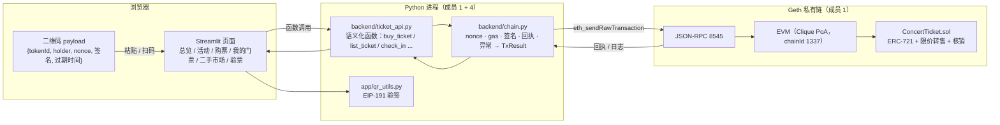

# 系统架构（成员 1 / 4 视角）



## 一、为什么分成三层

| 层 | 负责 | 不负责 |
|---|---|---|
| 合约 | 所有**不可绕过**的规则：限购、限价、转售次数、一票一核销 | 用户体验、页面布局 |
| `ticket_api.py` | 把合约函数包成业务语义、算金额、统一返回 `ok/tx_hash/gas_used/error` | 不重新实现规则（不替代链上校验） |
| Streamlit | 展示、交互、二维码 | **不做任何"前端校验就算通过"的判断** |

页面上的每一个"可以/不可以"，最后都由合约的 `require` 决定。页面的 `canPurchase` 预检只是为了少发一笔注定失败、
还要花 gas 的交易，属于体验优化，不是安全边界。

## 二、一次购票的完整链路

```
用户点击「立即购买」
  → app/pages/2_buy.py: api.buy_ticket(event_id, "buyerB", 1)
  → backend/ticket_api.py: 读 concertEvents(eventId) 取票价，构造 purchaseTickets{value: price*qty}
  → backend/chain.py: estimate_gas（失败则直接返回 revert 原因，不花 gas）
                      get_transaction_count(pending) → nonce
                      maxFeePerGas = baseFee*2 + 1 gwei
                      eth_account 本地签名 → eth_sendRawTransaction
                      wait_for_transaction_receipt（超时 120s）
  → 返回 TxResult(ok, tx_hash, block_number, gas_used)
  → 页面再调用 ownerOf(tokenId) 读回真实票主并对照
```

## 三、链上状态与前端字段的对应

| 页面字段 | 来源 |
|---|---|
| 活动名称 / 票价 / 库存 / 限购 / 预售 | `concertEvents(eventId)`（public mapping 的 getter） |
| 剩余票数 | `remainingSupply(eventId)` |
| 票主 | `ownerOf(tokenId)` |
| 是否在售 / 挂牌价 / 转售次数 / 是否核销 | `tickets(tokenId)` |
| 该票属于哪个活动 | `tokenToEvent(tokenId)` |
| 动态转售上限 | `getMaxResalePrice(tokenId)` |
| 购票资格预检 | `canPurchase(eventId, account, qty)` |
| 我的门票列表 | 扫 `Transfer` 事件 + 逐个 `ownerOf` 复核（合约没继承 ERC721Enumerable） |
| 交易证据 / Gas | `eth_getTransactionReceipt` |

## 四、二维码验票为什么不放在链上

链上只能验证"这张票有没有被核销过"，无法验证"站在闸机前的人是不是票主"。
所以二维码里放了 **持票人私钥对票根内容的签名**，验票端做两件事：

1. **链下**：恢复签名地址 == `payload.holder`，且 `holder == ownerOf(tokenId)`，且未过期；
2. **链上**：`checkIn(tokenId)` 把 `used` 置真，同一张票第二次核销必然 revert。

二维码里带 `nonce` 和 `expires_at`，截图转发会过期；转售后旧票主的二维码会因
`ownerOf` 不一致被拒——这两个场景在 `results/demo_report.md` 的 T14 系列里有说明。

## 五、故障边界

| 情况 | 现象 | 处理 |
|---|---|---|
| 节点没启动 | 页面顶部红字提示，不渲染业务 | `./blockchain/start_node.sh` |
| 合约地址变了 | 页面提示未部署 | `python backend/deploy.py` |
| 交易 revert | 页面显示合约 return 的原因（如 `Price exceeds dynamic limit`） | 按提示改正参数 |
| 节点卡住不产块 | 交易一直 pending，120s 超时 | 看 `blockchain/geth.log`，必要时 `--reset` |
